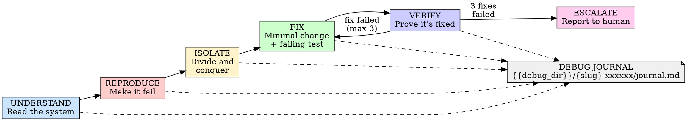

<!-- Reproduction-loop menu, ranked hypotheses, and instrumentation tagging adapted from the "diagnosing-bugs" skill in github.com/mattpocock/skills (MIT). -->

# Debugging

**This is a rigid skill.** Follow steps exactly.

## Overview

Find the root cause. Prove it. Then fix it.

**Core principle:** If you can't explain why the bug happens, you don't know if your fix is correct.

**Violating the letter of the rules is violating the spirit of the rules.**

## Pre-flight: Model Recommendation

**Your current effort level is `{{effort_level}}`.** Skip this step silently if effort is `high`, `xhigh`, or `max` (the scale is `low` < `medium` < `high` < `xhigh` < `max`, so `xhigh` and `max` are already above `high`) AND you are Opus (1M context). Otherwise ask via `AskUserQuestion` (header "Model check"; options "Continue anyway" / "Cancel — I'll switch first"):

> "Do you want to switch? Falsifiable hypothesis formation and resisting the temptation to jump to fixes benefit from deeper reasoning.
>
> Recommended: Opus (1M context) at high effort.
>
> To switch: cancel, run `/model opus[1m]` and `/effort high`, then re-invoke this skill."

If the user selects "Cancel — I'll switch first": output the switching commands and stop. Do not proceed with the skill. Ask once per conversation: a skill invoked by another skill skips this step when the recommendation was already shown. In a non-interactive run (`--noninteractive`, `GROUNDWORK_RUNNER_MODE=true`, or `GROUNDWORK_BATCH_MODE=true`), skip the prompt and continue on the current model.

## When to Use

**Always:**
- Test failures
- Unexpected behavior
- Error messages
- Regressions
- "It works on my machine" situations

**Exceptions (ask your human partner):**
- Typos and obvious one-character fixes
- Configuration value changes with known correct values

Thinking "I already know the fix"? Stop. That's guessing, not debugging.

## The Iron Law

```
NO CODE CHANGES UNTIL YOU CAN EXPLAIN THE ROOT CAUSE
```

**No exceptions:**
- Don't "try a quick fix to see if it works"
- Don't change multiple things hoping one helps
- Don't fix symptoms instead of causes
- Don't skip reproduction because "it's obvious"

Understand first. Fix second. Period.

## Redact Before You Show or Store

This skill has you execute commands, paste outputs, and persist captured artifacts into the journal, subagent prompts, and escalation reports. **Redact every secret first** — API keys, tokens, credentials, PII — writing `[REDACTED]` in its place. Build reproductions against environment variables, so the credential stays in the environment instead of in what you show. Captured artifacts (HAR files, headers, logs) carry auth material: quote only the lines that carry the signal. If redacted output is not enough to diagnose, say so and ask your human partner — never widen the redaction on your own.

## Instrumentation Tagging

Every temporary log line you add — in any phase — carries a unique prefix for this run, e.g. `[DEBUG-a4f2]`. Cleanup becomes a single grep for the prefix; untagged debug logs survive forever.

## Five-Phase Workflow



## Phase 1: UNDERSTAND

Read the system. Check your assumptions. Don't touch anything yet.

Before investigating the bug, understand the code it lives in. Your mental model is a hypothesis — treat it as one.

**Required steps:**
1. Read the relevant source files end-to-end (not just the failing line)
2. Trace the code path from input to failure
3. Identify what the code *should* do vs. what it *does*
4. Check the obvious: dependencies installed? correct branch? config valid? environment correct?
5. Read error messages completely — stack traces, line numbers, all of it
6. Use git to fetch recent changes
7. For multi-component systems (API → service → database, CI → build → deploy), instrument at each boundary *before* forming hypotheses. Run once, collect evidence from every layer, then analyze where the chain breaks.

**Example — multi-layer instrumentation:**
```
System: Frontend → API Gateway → Auth Service → Database
Step 1: Add logging at each boundary (request in, response out)
Step 2: Trigger the failure once
Step 3: Read the logs layer by layer:
  - Frontend sent correct request ✓
  - API Gateway forwarded correctly ✓
  - Auth Service received request ✓
  - Auth Service → Database query returned empty result ✗
  - Auth Service returned 500 to Gateway
Conclusion: Problem is between Auth Service and Database.
Now investigate that specific boundary.
```
Don't guess which layer is broken. Let the evidence from all layers tell you.

<Good>
```
Read the full function. Trace the call chain from the API endpoint
through the service layer to the database query. Found that
`getUserById` is called with a string ID but the query expects
an integer. The type mismatch happens at the controller layer.
```
Reads the system, traces the path, identifies the discrepancy
</Good>

<Bad>
```
The error says "invalid input" so I'll add input validation
to the endpoint.
```
Didn't read the code, didn't trace the path, guessed at a fix
</Bad>

**Check the plug:**
- Is the service running?
- Is the database connected?
- Are environment variables set?
- Is the right version deployed?
- Did a dependency update break something?

Don't assume the obvious is fine. Verify it.

## Phase 2: REPRODUCE

Make it fail. Consistently. On demand.

If you can't reproduce it, you can't prove you fixed it. Observation before theory — watch what actually happens, don't theorize about what might happen.

**Required steps:**
1. Create a minimal reproduction (smallest input that triggers the bug)
2. Run it. Watch it fail. Note the exact output.
3. Run it again. Confirm it fails the same way.
4. Add instrumentation (logging, breakpoints) if the failure path is unclear
5. Document the reproduction steps in the debug journal

**Ways to construct a reproduction, roughly in order:**
1. Failing test at whatever seam reaches the bug
2. `curl` / HTTP script against a running dev server
3. CLI invocation with a fixture input, diffing stdout against a known-good snapshot
4. Headless browser script (Playwright/Puppeteer) asserting on DOM/console/network
5. Replay a captured trace — save the real request/payload/event log to disk and replay it through the code path in isolation
6. Throwaway harness — minimal subset of the system (one service, stubbed deps) exercising the bug path with a single call
7. Property/fuzz loop — for "sometimes wrong output", run 1000 random inputs and look for the failure mode
8. Bisection harness — if the bug appeared between two known states, automate "boot at state X, check, repeat" so `git bisect run` can drive it
9. Differential loop — same input through old vs. new version (or two configs), diff the outputs

**Treat the reproduction as a product — tighten it:**
- Faster? (cache setup, skip unrelated init, narrow scope)
- Sharper signal? (assert the specific symptom, not "didn't crash")
- More deterministic? (pin time, seed RNG, isolate filesystem, freeze network)

A 30-second flaky reproduction is barely better than none; a 2-second deterministic one is a debugging superpower. For intermittent bugs, the goal is not a clean repro but a **higher reproduction rate** — loop the trigger 100×, parallelize, stress it, narrow timing windows — until the failure is frequent enough to debug against.

**Reproduction checklist:**
- [ ] Can trigger the bug on demand
- [ ] Same failure every time (or documented intermittent pattern)
- [ ] Minimal reproduction — removed everything not needed to trigger it
- [ ] Exact error output recorded

### Phase 2 Gate — MANDATORY

Before proceeding to Phase 3, your debug journal MUST contain:
- The exact command/steps you **executed** (not theorized about)
- The exact error output you **observed** (not inferred from code)
- Confirmation this matches the user-reported symptoms

**Static code reading is NOT reproduction.** If you have only read source files and formed theories about what might happen, you are still in Phase 1.

**Simulation is NOT reproduction.** Writing scripts that mimic what the code *would* do (e.g., Node.js scripts simulating CoffeeScript logic, Python scripts simulating import resolution) is theorizing, not reproducing. Run the actual code path instead.

**Can't reproduce?**
- Check environment differences
- Check timing/race conditions
- Check data-dependent paths
- Add logging and wait for it to recur
- Don't guess. If you can't reproduce it, you can't fix it.

**Can't execute directly?** (GUI app, external service, no local environment)
1. Add temporary logging/instrumentation to the actual code FIRST
2. Ask the user to trigger the bug with your instrumentation in place
3. Read the instrumented output — this is your reproduction evidence
4. Do NOT proceed to Phase 3 based on code reading alone
5. If instrumentation isn't possible either, document WHY in the journal and escalate to your human partner for reproduction assistance

## Phase 3: ISOLATE

Narrow the search space. One variable at a time.

Form hypotheses. Make them falsifiable. Test them. Eliminate possibilities systematically — don't jump to conclusions.

**Generate 3–5 ranked hypotheses BEFORE testing any of them.** Testing the first plausible idea anchors the investigation on it; a ranked field of candidates is the cure. Each hypothesis must be falsifiable — state the prediction it makes:

> Format: "If X is the cause, then changing Y will make the bug disappear / changing Z will make it worse."

A hypothesis whose prediction you cannot state is a vibe — sharpen it or drop it. Record the ranked list in the journal's Active section before the first test. When a human partner is present, show them the ranking before you start — they often re-rank instantly ("we just changed #3's area") or rule out hypotheses they've already tested; don't block on their reply in an unattended run, proceed with your ranking.

**Required steps:**
1. Generate 3–5 ranked, falsifiable hypotheses ("the bug occurs because X; if I do Y, I should see Z")
2. Test them in rank order. One change at a time.
3. Record the result: confirmed or eliminated.
4. Repeat until the root cause is isolated.

### Investigation Techniques

| Technique | When to Use | How |
|-----------|-------------|-----|
| **Binary search** | Large code path, unknown location | Comment out half the code path. Bug gone? It's in that half. Repeat. |
| **Differential debugging** | Worked before, broken now | Compare working vs. broken state. `git bisect`, diff configs, diff dependencies. |
| **Minimal reproduction** | Complex system, many variables | Strip away components until the simplest case that still fails. |
| **Working backwards** | Clear error, unclear cause | Start at the error. Trace backwards through the call chain. |
| **Rubber duck** | Stuck, circular thinking | Explain the bug out loud, step by step. The gap in your explanation is the gap in your understanding. |

### Spawning Investigation Subagents

When dispatching subagents for parallel investigation:
1. **Pass context forward** — Include files already read and findings so far in the subagent prompt, not just "investigate X"
2. **Specify concrete actions** — "Run `pip install --target $(mktemp -d)` and return the error output" not "explore the dependency setup"
3. **Require reproduction** — Subagents must execute the failing operation, not just read code
4. **Reference the debug journal** — Pass the **literal resolved journal path** (not the `{slug}` pattern) and tell the subagent to read it first so it doesn't repeat prior work
5. **Validate findings** — If a subagent returns without direct evidence (only file reads, no command output), run the reproduction yourself before accepting its conclusions

**One thing at a time:**
- Change one variable per test
- Revert changes that didn't help
- Don't combine hypotheses ("maybe it's A and B together")
- If you changed two things and it worked, you don't know which one fixed it

<Good>
```
Hypothesis: The timeout occurs because the connection pool is exhausted.
Test: Log active connections before the failing request.
Result: 50/50 connections active. Confirmed — pool exhaustion.
Next: Why aren't connections being released?
```
Falsifiable hypothesis, tested, confirmed, asks next question
</Good>

<Bad>
```
Might be a timeout issue. Let me increase the timeout to 30s.
Also bump the connection pool to 100. And add a retry.
```
Three changes at once, no hypothesis, no understanding
</Bad>

## Phase 4: FIX

State the root cause. Write a failing test. Make the minimal fix.

**Required steps:**
1. **State the root cause** — Write it in the debug journal with a verification level (see Verification Levels below)
2. **Write a failing test** — Invoke `Skill(skill="groundwork:test-driven-development")` and follow the TDD cycle. The test must reproduce the exact bug, at a **correct seam**: one where the test exercises the real bug pattern as it occurs at the call site. If the only available seam is too shallow to replicate the chain that triggered the bug, a regression test there gives false confidence — **the absence of a correct seam is itself a finding**: record it in the journal, flag it for architecture review, and say so in the fix report instead of forcing a hollow test.
3. **Minimal fix only** — Change the least amount of code to fix the root cause. Don't refactor. Don't "improve" nearby code. Don't fix other bugs you noticed.
4. **One change at a time** — If the fix requires multiple changes, make them incrementally.

<Good>
```
Root cause: getUserById passes string ID to SQL query that
expects integer. Connection pool exhaustion is a symptom —
queries hang waiting for type coercion timeout.

Fix: Parse ID to integer at the controller layer before
passing to the service.
```
Root cause stated, explains the symptom chain, minimal targeted fix
</Good>

<Bad>
```
Fixed the timeout by:
- Increasing pool size to 200
- Adding parseInt to 5 different endpoints
- Refactoring the connection manager
- Adding retry logic to all database calls
```
Shotgun fix, no root cause stated, changes way beyond the bug
</Bad>

## Phase 5: VERIFY

Prove the fix works. Prove nothing else broke. Get a fresh perspective.

**Required steps:**
1. Run the failing test — it must pass now
2. Run the full test suite — nothing else broke
3. Re-run the original reproduction — the bug is gone
4. Review your fix with fresh eyes — does it actually address the root cause, or mask it?
5. Check for related code paths — could the same bug exist elsewhere?

**Verification checklist:**
- [ ] Failing test now passes (or the no-correct-seam finding is recorded and reported)
- [ ] Full test suite passes
- [ ] Original reproduction no longer triggers the bug
- [ ] Fix addresses root cause (not symptoms)
- [ ] No unrelated changes included
- [ ] Related code paths checked for same bug
- [ ] The commit message states the confirmed root cause and the evidence that confirmed it, so the next debugger of this area starts from the answer
- [ ] All `[DEBUG-xxxx]` instrumentation removed (grep the run's tag)
- [ ] Throwaway harnesses and capture files deleted or left inside the run's journal directory

**Fix didn't work?** Go back to Phase 3. Your root cause analysis was wrong. Don't patch the patch — re-investigate.

## Escalation Rules

**3-fix limit.** If your third fix attempt fails, stop and escalate.

Three failed fixes means your root cause analysis is wrong. More attempts won't help — you need a different perspective.

**Question the architecture.** Three failed fixes often signal something deeper than an incomplete investigation. The bug may exist because the design is fundamentally unsound — a race condition baked into the concurrency model, a data integrity problem caused by a missing constraint, a failure mode that the architecture doesn't account for. When you escalate, shift the question from "help me fix this bug" to "is this design sound?"

**Escalation report:** use the format in `${CLAUDE_PLUGIN_ROOT}/references/debug-escalation.md`, and send it only after reverting every failed fix attempt — the codebase stays clean.

**After a resolved bug — and after every escalation — recommend `/groundwork:retro`:** a bug that needed this workflow is the strongest signal the environment needs a deterministic check, a navigation pointer, or a seam fix. Run it in this session while the evidence is still here.

## Debug Journal

Maintain a persistent debug journal **at an invocation-unique path** — the slug plus this run's identity — never at a fixed slug-only name. Concurrent debugging of the same bug in the same project would silently overwrite a fixed journal; a unique path gives every invocation its own intact record, and prior work is found by slug prefix when resuming.

`{{debug_dir}}` resolves inside the selected project's root (mirroring `{{plans_dir}}`), so the same bug slug in two monorepo projects produces two distinct journal locations instead of colliding at the repository root.

**Derive the slug once, at the start of Phase 1:** kebab-case of the bug's one-line description, truncated to 40 characters (e.g. "login timeout on token refresh" → `login-timeout-on-token-refresh`). Then allocate the journal's run directory **once** — an atomically unique `mktemp` directory keyed on the slug:

```bash
mkdir -p {{debug_dir}}
grep -qxF '.debug/' .gitignore 2>/dev/null || printf '.debug/\n' >> .gitignore
RUN_DIR="$(mktemp -d "{{debug_dir}}/${SLUG}-XXXXXX")"
JOURNAL_PATH="$RUN_DIR/journal.md"
```

The `.gitignore` pattern is unanchored, so it covers debug directories at any project depth; the append is idempotent.

Use that **literal resolved path** everywhere for the rest of the session — including in every subagent prompt — so the path can never drift between derivations, and **return it in your final output and any handoff** so the next session can adopt it directly.

**Resuming prior work on the same slug:** find earlier run directories by slug prefix — `ls -dt {{debug_dir}}/${SLUG}-*/` — and read the journal inside. If more than one match exists, do not silently pick one: use the literal journal path from your handoff, or ask the user which run to continue. Then continue writing to your own invocation-unique journal (never a shared `current` pointer, never the older file).

**One-time migration:** if a legacy journal for this slug exists at the unscoped repository-root location `.debug/{slug}.md` while `{{debug_dir}}` points elsewhere, move it into a fresh run directory with two visible commands and say so — do not keep reading the legacy location:

```bash
RUN_DIR="$(mktemp -d "{{debug_dir}}/{slug}-migrated-XXXXXX")"
mv .debug/{slug}.md "$RUN_DIR/journal.md" # legacy location migration
```

```markdown
# Debug: {slug}

## Status
[Active | Root Cause Found | Fixed | Escalated]

## Symptoms
- [What the user or test reported]
- [Exact error messages]
- [When it started / what changed]

## Reproduction
### Command Executed
[The exact command you ran — NOT theoretical steps, NOT code you read]

### Actual Output
[The exact error/output you observed when you ran it, secrets redacted — same rule as everything else you show or store]

### Expected Output
[What should have happened instead]

### Matches User Report?
[Yes/No — does this reproduce the same symptoms the user described?]

## Hypotheses

### Active
Ranked before the first test; each with the prediction that would confirm or refute it.
- [ ] [Hypothesis]: if X is the cause, then [Y] will make the bug disappear / [Z] will make it worse

### Eliminated
- [x] [Hypothesis]: Eliminated because [evidence]

## Evidence Log
| # | Action | Observation | Conclusion |
|---|--------|-------------|------------|
| 1 | [what you did] | [what happened] | [what it means] |

## Root Cause
**Verification level:** [Verified | Corroborated | Unverified | Contradicted]

[Root cause statement]

[Evidence that confirms it]

## Fix
[What was changed and why]

## Resolution
[Final status, test references, PR link]
```

**Update the journal as you work.** Every hypothesis, every test, every result goes in the journal. When context compacts, the journal remains.

## Verification Levels

Root cause claims require a confidence level. This prevents false confidence and forces honest assessment.

| Level | Meaning | Enough to fix? |
|-------|---------|----------------|
| **Unverified** | Single observation or logical inference only | No — gather more evidence first |
| **Corroborated** | Independent observations all point to the root cause and the competing hypotheses are eliminated. The minimum for Phase 4. | Yes — proceed to fix |
| **Verified** | Corroborated, and then proven in Phase 5: the failing test reproduced the bug before the fix and passes after it, and the original reproduction no longer fails | The outcome of Phase 5, never an input to Phase 4 |
| **Contradicted** | Evidence conflicts with the hypothesis | No — eliminate this hypothesis |

**Rule: Never fix on less than Corroborated.** A single observation is a guess. Go back to Phase 3.

## Common Rationalizations

| Excuse | Reality |
|--------|---------|
| "I already know the fix" | Then prove the root cause first. Takes 2 minutes if you're right. |
| "Let me just try this quick fix" | Quick fixes become permanent. Understand first. |
| "The fix is obvious" | Obvious fixes for wrong root causes create new bugs. |
| "I'll investigate after I fix it" | You won't. And you can't verify a fix you don't understand. |
| "It's just a typo / off-by-one" | Verify. "Just a typo" has been wrong more times than right. |
| "I changed 3 things and it works now" | You don't know which one fixed it. Revert two. |
| "Reproducing is too hard, let me just fix it" | If you can't reproduce it, you can't verify the fix. |
| "I don't need a journal for something this simple" | Simple bugs that need journals are the ones that spiral. |
| "The tests pass, so it's fixed" | Tests pass ≠ root cause addressed. The symptom might be masked. |
| "Let me add a retry / increase the timeout" | That's masking, not fixing. Find why it fails. |
| "It works on my machine" | Then your machine isn't the one with the bug. Reproduce there. |
| "I've been debugging this for hours, let me just ship it" | Sunk cost. Escalate instead of shipping a guess. |
| "I'll simulate the logic to understand it" | Run the actual code. Simulation scripts are theories, not evidence. |
| "The subagent explored the codebase thoroughly" | Did it run the failing operation? Reading files is Phase 1, not Phase 3. |

## Signals From Your Human Partner

During interactive debugging, your human partner's reactions are a signal channel. Frustration and redirection mean your process is off — not that the human is being difficult.

| What they say | What it means | What to do |
|---------------|---------------|------------|
| "Is that not happening?" | You assumed something without verifying | Go back and verify with evidence |
| "Stop guessing" | You're proposing fixes without understanding | Return to Phase 1 — read the system |
| "We're going in circles" / frustrated tone | Your approach isn't working | Step back. Re-read from scratch. Your mental model is wrong. |
| "Did you actually check?" | You claimed something without evidence | Gather evidence first, then report what you found |
| "That's not the problem" | You're investigating the wrong thing | Ask what they're seeing. Their context is broader than yours. |
| "Just revert" | Your fixes are making things worse | Revert everything. Return to Phase 2 with a clean slate. |

**Rule:** Treat pushback as data, not criticism. If your human partner redirects you, the most productive response is to follow the redirect — not to defend your hypothesis.

## Red Flags — STOP and Go Back to Phase 1

- Changing code without stating the root cause
- Multiple changes at once ("let me try a few things")
- Fix attempt #4+
- "I think it might be..." without a falsifiable test
- Increasing timeouts, pool sizes, or retry counts as a "fix"
- Adding error suppression (empty catch blocks, silent fallbacks)
- Can't explain why the fix works
- Fix is larger than the bug warrants
- Fixing a different bug than the one you started with
- No reproduction case
- No failing test
- Skipping the debug journal
- Forming hypotheses based only on code reading without running anything
- Writing simulation scripts instead of running the actual failing code
- Spawning investigation subagents without specifying what to execute

**All of these mean: Stop. Go back to Phase 1. Understand the system.**

## When Stuck

| Problem | Solution |
|---------|----------|
| Can't reproduce | Work through the reproduction menu in Phase 2. |
| Hypothesis keeps being wrong | Step back. Re-read the code from scratch. Your mental model is wrong. |
| Fix works but don't understand why | Not a fix — the Iron Law applies. Revert it, then investigate why it worked. |
| Too many variables | Shrink the reproduction (Phase 2) until one variable remains. |
| Intermittent failure | Add instrumentation. Look for race conditions, timing, external state. |
| Stuck in a loop | Rubber duck. Explain the bug step by step. The gap is the clue. |
| Bug disappeared | It's hiding. Check if something else changed. Don't declare victory. |
| Fix breaks other tests | A failed fix: back to Phase 3, as at the end of Phase 5. |

## When Investigation Finds No Root Cause

Sometimes systematic investigation legitimately concludes without a clear root cause — environmental issues, timing-dependent failures, external service flakiness, or bugs that disappear under observation. This is rare, but it happens. When it genuinely does, follow *When investigation finds no root cause* in `${CLAUDE_PLUGIN_ROOT}/references/debug-escalation.md`: document what was eliminated, mitigate without calling it a fix, instrument for recurrence, record the journal as "Inconclusive", and tell your human partner plainly.

**Caveat:** 95% of "no root cause found" conclusions are actually incomplete investigations. Before declaring inconclusive, honestly assess:
- Did you complete all five phases?
- Did you actually reproduce the failure, or just read the code?
- Did you test falsifiable hypotheses, or just form opinions?
- Is the journal thorough, or are there gaps?

If there are gaps, go back and fill them. "Inconclusive" is a legitimate outcome — but only after exhausting the process, not instead of it.

## Example: Full Walkthrough

**Bug report:** "API returns 500 on user profile page for some users"

### Phase 1: UNDERSTAND

Read the profile endpoint handler, the user service, and the database query. The endpoint calls `getUserProfile(id)` which joins `users` and `preferences` tables.

Check the plug: database connected, service running, other endpoints working fine.

### Phase 2: REPRODUCE

```bash
curl -s localhost:3000/api/profile/42   # 200 OK
curl -s localhost:3000/api/profile/107  # 500 Internal Server Error
```

Consistent. User 42 works, user 107 fails. Minimal reproduction found.

Error log: `TypeError: Cannot read property 'theme' of null`

### Phase 3: ISOLATE

**Ranked hypotheses, written down before testing any:**
1. User 107 has no `preferences` row, and the profile query assumes one exists.
2. The row exists but the JOIN drops it (wrong join key or filter).
3. A stale cache serves an older, incompatible profile shape for this user.

**Test #1:** Query the database directly.
```sql
SELECT * FROM preferences WHERE user_id = 107;
-- Empty result set
```
**Result:** Confirmed — user 107 has no preferences row. The same query eliminates #2 (there is no row to join).

**Test #2:** Re-run the reproduction with a full stack trace.
```text
TypeError: Cannot read property 'theme' of null
    at getUserProfile (src/users/profile.ts:42)
    at handler (src/api/profile.ts:18)
```
**Result:** Confirmed. The failing access is the `user.preferences.theme` line read in Phase 1, which has no null check, and the call reaches it straight from the handler — no cache on the stack, so #3 drops out.

**Root cause:** `getUserProfile` accesses `preferences.theme` without null-checking the join result. Users without a preferences row trigger a TypeError.

**Verification level:** Corroborated — two independent observations (the missing row; the unchecked access on a cache-free stack) agree, and both competing hypotheses are eliminated.

### Phase 4: FIX

**Failing test:**
```typescript
test('returns default theme when user has no preferences', async () => {
  const user = await createUser({ id: 999 }); // no preferences row
  const profile = await getUserProfile(999);
  expect(profile.theme).toBe('default');
});
```

Test fails with `TypeError: Cannot read property 'theme' of null`. Correct failure.

**Fix:**
```typescript
const theme = user.preferences?.theme ?? 'default';
```

Test passes.

### Phase 5: VERIFY

Every box in the Phase 5 checklist ticked:

- [x] Failing test passes
- [x] Full test suite: all green
- [x] `curl localhost:3000/api/profile/107`: 200 OK, theme is "default" — the original reproduction no longer fails
- [x] Fix addresses root cause: null preferences handled
- [x] No unrelated changes included
- [x] Checked other code paths: `preferences.language` has same bug — filed separate issue
- [x] Commit message states the root cause: the LEFT JOIN returns null `preferences` and the code assumed it exists
- [x] No `[DEBUG-xxxx]` lines remain (grepped for this run's tag)
- [x] Throwaway capture files deleted

Done.

**Verification level:** Verified — the failing test reproduced the bug before the fix and passes after it, and the original reproduction no longer fails.

## Final Rule

```
Root cause identified → Fix with failing test → Verify fix
Otherwise → not debugging, just guessing
```

No exceptions without your human partner's permission.
