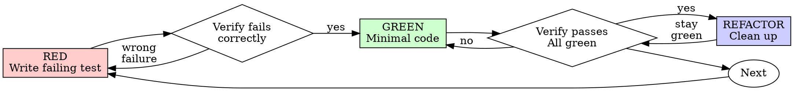

# Test-Driven Development (TDD)

**This is a rigid skill.** Follow steps exactly.

## Overview

Write the test first. Watch it fail. Write minimal code to pass.

**Core principle:** If you didn't watch the test fail, you don't know if it tests the right thing.

**Violating the letter of the rules is violating the spirit of the rules.**

**Test-quality standard:** Write tests to the same bar they'll be judged against. `${CLAUDE_PLUGIN_ROOT}/references/checklists/testing.md` is the canonical test-quality checklist — pyramid, DAMP, mocking gates, what not to test, coverage. This skill is the *workflow*; that file is the *standard* (the `test-quality-reviewer` agent grades against it).

## When to Use

**Always:**
- New features
- Bug fixes
- Refactoring
- Behavior changes

**Exceptions (ask your human partner):**
- Throwaway prototypes
- Generated code
- Configuration files

Thinking "skip TDD just this once"? Stop. That's rationalization.

## The Iron Law

```
NO PRODUCTION CODE WITHOUT A FAILING TEST FIRST
```

Write code before the test? Delete it. Start over.

**No exceptions:**
- Don't keep it as "reference"
- Don't "adapt" it while writing tests
- Don't look at it
- Delete means delete

Implement fresh from tests. Period.

## Where Tests Live: Seams

A **seam** is the public boundary a test is written against — the interface where behavior is observable without reaching inside the implementation. Tests live at seams, never against internals.

**Start from the recorded seams.** When the task or plan records `Test Seams`, that choice was made during planning with the human in the room: write the cycle's tests there.

**The fallback — when no seams are recorded, or a recorded seam turns out not to reach the behavior:**
- Pick the **highest existing seam** that reaches the behavior (a pure-function seam for pure logic, an HTTP/integration seam for wiring, one E2E seam for critical journeys)
- Prefer existing seams over inventing new ones; the fewer seams across a codebase, the better
- Record the choice where the next session will find it (task file, plan, or the commit message when neither is writable) so it stops being a decision

**In a planned or unattended run (a task, a plan, batch or runner mode), choosing is yours — never stop to ask.** In a free-form interactive session with no task or plan, name the seams you chose in one line before the first test; the user can redirect, and no question is needed.

Testing *past* an interface — mocking internal collaborators, testing private methods, verifying through a side channel — couples the test to implementation. If you feel the need to test past the seam, the module is probably the wrong shape; note it for review instead.

## Red-Green-Refactor



### RED - Write Failing Test

Write one minimal test showing what should happen.

<Good>
```typescript
test('retries failed operations 3 times', async () => {
  let attempts = 0;
  const operation = () => {
    attempts++;
    if (attempts < 3) throw new Error('fail');
    return 'success';
  };

  const result = await retryOperation(operation);

  expect(result).toBe('success');
  expect(attempts).toBe(3);
});
```
Clear name, tests real behavior, one thing
</Good>

<Bad>
```typescript
test('retry works', async () => {
  const mock = jest.fn()
    .mockRejectedValueOnce(new Error())
    .mockRejectedValueOnce(new Error())
    .mockResolvedValueOnce('success');
  await retryOperation(mock);
  expect(mock).toHaveBeenCalledTimes(3);
});
```
Vague name, tests mock not code
</Bad>

**Requirements:**
- One behavior
- Clear name — in the project's domain language: when the project's glossary exists (`glossary.md` in the specs directory the dispatch names), name tests with its canonical terms and honor its `Avoid` lists; a missing term is one to report for `domain-modeling`, never a synonym to invent
- Real code (no mocks unless unavoidable)

### Verify RED - Watch It Fail

**MANDATORY. Never skip.**

```bash
npm test path/to/test.test.ts
```

Confirm:
- Test fails (not errors)
- Failure message is expected
- Fails because feature missing (not typos)

**Test passes?** You're testing existing behavior. Fix test.

**Test errors?** Fix error, re-run until it fails correctly.

### GREEN - Minimal Code

Write simplest code to pass the test.

<Good>
```typescript
async function retryOperation<T>(fn: () => Promise<T>): Promise<T> {
  for (let i = 0; i < 3; i++) {
    try {
      return await fn();
    } catch (e) {
      if (i === 2) throw e;
    }
  }
  throw new Error('unreachable');
}
```
Just enough to pass
</Good>

<Bad>
```typescript
async function retryOperation<T>(
  fn: () => Promise<T>,
  options?: {
    maxRetries?: number;
    backoff?: 'linear' | 'exponential';
    onRetry?: (attempt: number) => void;
  }
): Promise<T> {
  // YAGNI
}
```
Over-engineered
</Bad>

Don't add features, refactor other code, or "improve" beyond the test.

### Verify GREEN - Watch It Pass

**MANDATORY.**

```bash
npm test path/to/test.test.ts
```

Confirm:
- Test passes
- Other tests still pass
- Output pristine (no errors, warnings)

**Test fails?** Fix code, not test.

**Other tests fail?** Fix now.

### REFACTOR - Clean Up

After green only:
- Remove duplication
- Improve names
- Extract helpers

Keep tests green. Don't add behavior.

**Lint gate (if project has a linter):**

After refactoring, run the project's lint command on changed files only:

```bash
# Example: ruff check <changed-files>, eslint <changed-files>, cargo clippy
```

Catch lint violations NOW — before the next action item adds more code on top. The specific command comes from the project's CLAUDE.md. If you don't know it yet, run it once on a file you just edited. If it passes, move on. If it fails, fix before proceeding.

**Do NOT defer lint fixes to "after implementation."** Lint errors compound — a single import-style choice (e.g., `from __future__ import annotations`) can cascade through every subsequent file if not caught immediately.

### Repeat

Next failing test for next feature.

A second worked example (a bug fix, start to finish) is in `${CLAUDE_PLUGIN_ROOT}/references/testing-examples.md`.

## Good Tests

| Quality | Good | Bad |
|---------|------|-----|
| **Minimal** | One thing. "and" in name? Split it. | `test('validates email and domain and whitespace')` |
| **Clear** | Name describes behavior | `test('test1')` |
| **Shows intent** | Demonstrates desired API | Obscures what code should do |

## What NOT to Test

The canonical skip-list lives in `${CLAUDE_PLUGIN_ROOT}/references/checklists/testing.md`. **Rule of thumb:** if a test would only fail when someone *intentionally* changes behavior (static markup, CSS, element counts, presentational-only components), it's preventing change, not testing it — don't write it. DO test conditional rendering, computed values, user interactions, state transitions, edge cases, and business rules.

## Rationalizations and Red Flags

Every excuse below asks for the same thing: code before a failing test. The answer is always the Iron Law — delete the code, start over with TDD.

| What you tell yourself | What is true |
|------------------------|--------------|
| "Too simple to test" | Simple code breaks. The test takes 30 seconds. |
| "I'll test after" | A test written after the code passes immediately, which proves nothing: it may test the implementation rather than the behavior, it misses the edge cases you forgot, and you never saw it catch a bug. |
| "I'll write all the tests first, then the implementation" | That is **horizontal slicing**: bulk tests verify *imagined* behavior. One test → one implementation → repeat, each test a tracer bullet for what the last cycle taught you. |
| "Tests after achieve the same goals" | Tests-after answer "What does this do?"; tests-first answer "What should this do?" Tests-after are biased by the implementation and verify only the edge cases you remembered. |
| "I already manually tested" | Manual testing is ad hoc: no record of what was tested, not re-runnable, and easy to forget cases under pressure. |
| "Deleting X hours of work is wasteful" | Sunk cost. The waste is keeping code you cannot trust. |
| "Keep it as reference, write tests first" | You will adapt it — that is testing after. Delete means delete. |
| "Need to explore first" | Explore, then throw the exploration away and start with TDD. |
| "The test is hard to write" | The test is telling you the design is unclear. Hard to test is hard to use. |
| "TDD will slow me down" / "TDD is dogmatic" | TDD is the pragmatic option: it finds bugs before the commit, catches regressions immediately, documents behavior, and makes refactoring safe. Shortcuts are debugging in production. |
| "A manual test is faster" | Manual proves nothing about edge cases, and you repeat it by hand at every change. |
| "Existing code has no tests" | You are improving it: add tests for the code you touch. |

**Stop and start over as soon as you notice any of these:** code written before its test · a test added after the implementation · a test that passed the first time · a failure you cannot explain · tests deferred to "later" · any "just this once" · "keep it as reference" or "adapt existing code" · "already spent X hours" · "this is different because…".

## Verification Checklist

Before marking work complete:

- [ ] Every new public function with logic (conditionals, computation, side effects) has a test; private helpers are covered through the public interface that calls them
- [ ] Tests sit at the recorded test seams, or at the highest existing seam chosen when none was recorded
- [ ] Watched each test fail before implementing
- [ ] Each test failed for expected reason (feature missing, not typo)
- [ ] Wrote minimal code to pass each test
- [ ] All tests pass
- [ ] Output pristine (no errors, warnings)
- [ ] Tests use real code (mocks only if unavoidable)
- [ ] Each acceptance criterion maps to at least one test, including its error paths and boundary cases (empty, null, max, off-by-one)

Can't check all boxes? You skipped TDD. Start over.

## When Stuck

| Problem | Solution |
|---------|----------|
| Don't know how to test | Write wished-for API. Write assertion first. Ask your human partner. |
| Test too complicated | Design too complicated. Simplify interface. |
| Must mock everything | Code too coupled. Use dependency injection. |
| Test setup huge | Extract helpers. Still complex? Simplify design. |

## Coverage Requirements

The standard is `${CLAUDE_PLUGIN_ROOT}/references/checklists/testing.md` (loaded above): 80%+ of logic paths, never a test written only to raise the number, and no unit tests for purely presentational components. For an E2E test's shape, a coverage command, or a coverage-threshold config, take the matching sample from `${CLAUDE_PLUGIN_ROOT}/references/testing-examples.md` (E2E, coverage verification, jest thresholds).

## Debugging Integration

Bug found? Write failing test reproducing it. Follow TDD cycle. Test proves fix and prevents regression.

Never fix bugs without a test.

## Testing Anti-Patterns

Mocks are tools to isolate, not things to test. Run these gates before every mock; the ❌/✅ example for each is under *Mock examples* in `${CLAUDE_PLUGIN_ROOT}/references/testing-examples.md`:

```
BEFORE asserting on any mock element:
  Ask: "Am I testing real behavior or mock existence?"
  IF mock existence → delete the assertion or unmock the component
```

```
BEFORE adding any method to a production class:
  Ask: "Is this only used by tests?"
  IF yes → put it in test utilities instead
```

```
BEFORE mocking any method:
  1. "What side effects does the real method have?"
  2. "Does this test depend on any of those side effects?"
  IF yes → mock lower (the actual slow/external operation), not the method the test depends on
```

```
BEFORE creating any mock:
  Ask: "What type does the real implementation return?"
  Value vs. stream? Sync vs. async? Array vs. cursor?
  IF mock changes the abstraction type → fix it
```

### Red flags

- Assertion checks for `*-mock` test IDs
- Methods only called in test files
- Mock setup is >50% of test code
- `mockResolvedValue()` when real code returns a stream
- Mocking "just to be safe"

## Final Rule

```
Production code → test exists and failed first
Otherwise → not TDD
```

No exceptions without your human partner's permission.
